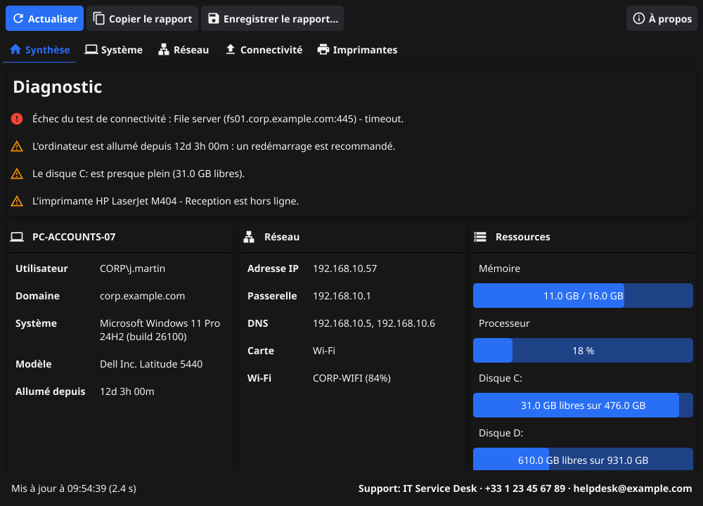

# PC Diag

🇬🇧 [English version](README.md) — la documentation de référence est en anglais.

**PC Diag** est un petit utilitaire de bureau, écrit en Go avec [Fyne](https://fyne.io), qui affiche sur un
seul écran les informations qu'un technicien du support demande en premier pour diagnostiquer un poste :
système, mémoire, stockage, cartes réseau, configuration IP, connectivité et imprimantes. Il signale aussi
les causes habituelles de panne (pas de passerelle, échec DHCP, disque plein, imprimante hors ligne, poste
non redémarré depuis des semaines…) et produit un rapport à coller dans un ticket.



## Fonctionnalités

| Onglet | Contenu |
| --- | --- |
| **Synthèse** | Diagnostic automatique (problèmes critiques en premier) et résumé de l'ordinateur, du réseau, des ressources, de la connectivité et des imprimantes. |
| **Système** | Nom du poste, utilisateur, domaine ou groupe de travail, OS et build, fabricant, modèle, numéro de série, BIOS, processeur, dernier démarrage, fuseau horaire, mémoire, fichier d'échange et disques. |
| **Réseau** | IP principale, passerelle, serveurs DNS, proxy et, pour chaque carte : état, type (filaire / Wi-Fi), IPv4 / IPv6, adresse MAC, passerelle, DNS, DHCP, vitesse du lien, SSID et signal. |
| **Connectivité** | Ping de la passerelle, interrogation de chaque serveur DNS, résolution de noms, accès Internet TCP et HTTP (détection de portail captif / proxy), plus vos propres tests. |
| **Imprimantes** | État du spouleur et imprimantes installées : port, pilote, imprimante par défaut / réseau / partagée, détection hors ligne. |

- **Copier le rapport** place un rapport texte dans le presse-papiers.
- **Enregistrer le rapport…** l'enregistre en `.txt` ou en `.json`.
- **Mode ligne de commande** : `pcdiag -report text` (ou `json`, avec `-o fichier`).
- **Configurable** avec un fichier `pcdiag.json` optionnel placé à côté de l'exécutable : contact du support,
  tests supplémentaires (serveur de fichiers, contrôleur de domaine, intranet…) et seuils d'alerte.
  Voir [`pcdiag.example.json`](pcdiag.example.json) et la section *Configuration* du [README](README.md#configuration).
- **Traduit** en français et en anglais : la langue suit celle du système.
- **Portable et en lecture seule** : un seul exécutable, sans installation ni droits administrateur ; aucune donnée n'est envoyée.

Les rapports restent volontairement en anglais pour pouvoir être lus par n'importe quelle équipe de support.

## Installation

Téléchargez l'archive correspondant à votre système sur la page
[Releases](https://github.com/Karobwe/pcdiag/releases). Sous Windows, téléchargez `pcdiag_<version>_windows_amd64.exe` et lancez-le directement, ou prenez l'archive `.zip` qui contient aussi un exemple de configuration `pcdiag.json`.
Pour un déploiement sur un parc (GPO, Intune, SCCM), utilisez `pcdiag_<version>_windows_amd64.msi` :

```powershell
msiexec /i pcdiag_0.2.0_windows_amd64.msi /qn CONFIGFILE="\\serveur\partage\pcdiag.json" DESKTOPSHORTCUT=1
```

Voir la section [Deploying with the MSI](README.md#deploying-with-the-msi)
(l'exécutable n'étant pas signé, SmartScreen peut demander une confirmation au premier lancement).

## Compiler

Prérequis : Go 1.24 ou plus récent et un compilateur C (sous Windows : [MSYS2](https://www.msys2.org/) avec
`mingw-w64-ucrt-x86_64-gcc`). Ensuite :

```bash
go run .          # lancer l'application
go test ./...     # lancer les tests
```

## Ajouter une traduction

Copiez `internal/i18n/translations/fr.json` vers `<langue>.json` (par exemple `de.json`) et traduisez les
valeurs. Le test `go test ./internal/i18n` vérifie qu'aucune chaîne ne manque.

## Licence

[MIT](LICENSE) © 2026 Attoumani Chanfi
