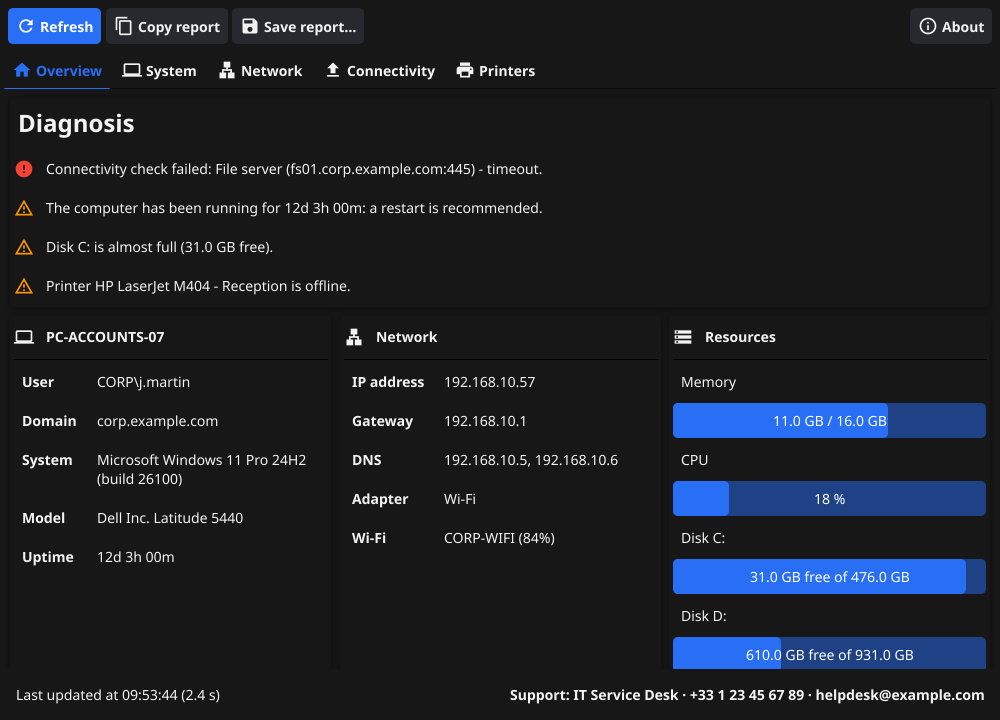

# PC Diag

[](https://github.com/Karobwe/pcdiag/actions/workflows/ci.yml)
[](https://pkg.go.dev/github.com/Karobwe/pcdiag)
[](LICENSE)

**PC Diag** is a small desktop utility, written in Go with [Fyne](https://fyne.io), that shows on a single
screen the information a helpdesk technician asks for first when troubleshooting a workstation: system,
memory, storage, network adapters, IP configuration, connectivity and printers. It also highlights the
usual suspects (no gateway, DHCP failure, full disk, offline printer, machine not restarted for weeks…) and
produces a report that can be pasted into a ticket.

🇫🇷 [Version française](README.fr.md)



## Features

| Tab | What you get |
| --- | --- |
| **Overview** | Automatic diagnosis (critical issues first) and a summary of the computer, network, resources, connectivity and printers. |
| **System** | Host name, user, domain or workgroup, OS and build, manufacturer, model, serial number, BIOS, CPU, last boot, uptime, time zone, memory, page file and disks. |
| **Network** | Primary IP, default gateway, DNS servers, proxy, and for every adapter: state, type (wired / Wi-Fi), IPv4 / IPv6, MAC address, gateway, DNS, DHCP, link speed, SSID and signal. |
| **Connectivity** | Ping of the default gateway, query of each DNS server, name resolution, Internet TCP and HTTP checks (captive portal / proxy detection), plus your own checks. |
| **Printers** | Print spooler state and installed printers with port, driver, default / network / shared flags and offline detection. |

- **Copy report** puts a plain-text report in the clipboard, ready to paste into a ticket or an e-mail.
- **Save report…** writes the report as `.txt`, or as `.json` for tooling.
- **Command-line mode** prints the same report without opening a window (handy over a remote shell).
- **Configurable** with an optional `pcdiag.json` file: support contact displayed in the window, extra
  connectivity checks (file server, domain controller, intranet…) and alert thresholds.
- **Localized**: English and French; the language follows the operating system.
- **Read-only and portable**: a single executable, no installation, no administrator rights, no data sent anywhere.

| Platform | Support |
| --- | --- |
| Windows 10 / 11 | Full (PowerShell / CIM for hardware, network and printers) |
| macOS | Full except per-adapter DHCP, link speed and Wi-Fi details |
| Linux | Full; serial number requires root, Wi-Fi details require NetworkManager, printers require CUPS |

## Installation

Download the archive for your platform from the [Releases](https://github.com/Karobwe/pcdiag/releases) page:

- **Windows**: unzip `pcdiag_<version>_windows_amd64.zip` and run `pcdiag.exe`. The executable is not signed:
  Windows SmartScreen may ask for a confirmation the first time.
- **macOS**: unzip and move *PC Diag.app* to *Applications*. As the app is not notarized, open it with
  right-click › *Open* the first time.
- **Linux**: extract the `.tar.xz` and run `sudo make install`, or run the binary from `usr/local/bin`.

With a Go toolchain and the [Fyne prerequisites](#building-from-source) you can also run
`go install github.com/Karobwe/pcdiag@latest`.

## Usage

Launch the application: information is collected automatically (it takes a few seconds, mostly for the
network tests). Use **Refresh** (`F5` or `Ctrl+R`) after a change, and **Run the checks again** in the
*Connectivity* tab to repeat only the network tests. `Ctrl+S` saves the report.

### Command line

```text
pcdiag [options]

  -report text|json   print a report without opening the window
  -o file             write the report to a file instead of the standard output
  -no-checks          skip the connectivity checks in report mode
  -config file        configuration file (default: pcdiag.json next to the executable)
  -version            print the version and exit
```

Examples:

```powershell
pcdiag.exe -report text                       # in a PowerShell or cmd window
pcdiag.exe -report json -o "$env:TEMP\diag.json"
```

<details>
<summary>Sample text report</summary>

```text
PC Diag report - PC-ACCOUNTS-07
===============================
  Generated:     2026-10-24 09:15:00 CEST
  Tool version:  v0.1.0

Findings
--------
  [CRITICAL] Connectivity check failed: File server (fs01.corp.example.com:445) - timeout.
  [WARNING] The computer has been running for 12d 3h 00m: a restart is recommended.
  [WARNING] Disk C: is almost full (31.0 GB free).
  [WARNING] Printer HP LaserJet M404 - Reception is offline.

System
------
  Hostname:          PC-ACCOUNTS-07
  User:              CORP\j.martin
  Domain:            corp.example.com
  Operating system:  Microsoft Windows 11 Pro 24H2 (build 26100)
  ...
```

</details>

## Configuration

PC Diag works without any configuration. To tailor it for your organization, copy
[`pcdiag.example.json`](pcdiag.example.json) to `pcdiag.json` **next to the executable** (or to
`%AppData%\pcdiag\config.json`, `~/Library/Application Support/pcdiag/config.json`,
`~/.config/pcdiag/config.json`) and edit it. Every key is optional; missing keys keep their default value.

```json
{
  "support": { "name": "IT Service Desk", "phone": "+33 1 23 45 67 89", "email": "helpdesk@example.com" },
  "connectivity": {
    "dnsTestHost": "www.microsoft.com",
    "internetTcp": "1.1.1.1:443",
    "httpUrl": "http://www.msftconnecttest.com/connecttest.txt",
    "httpExpect": "Microsoft Connect Test",
    "checks": [
      { "name": "File server", "type": "tcp",  "target": "fs01.corp.example.com:445" },
      { "name": "Intranet",    "type": "http", "target": "https://intranet.corp.example.com/" },
      { "name": "Internal DNS", "type": "dns", "target": "intranet.corp.example.com", "server": "10.0.0.10" }
    ]
  },
  "thresholds": { "memoryPercent": 90, "diskPercent": 90 }
}
```

| Key | Description |
| --- | --- |
| `support` | `name`, `phone`, `email`, `url` shown in the footer and the About dialog. |
| `connectivity.dnsTestHost` | Host name resolved by the DNS checks. |
| `connectivity.internetTcp` | `host:port` opened to test raw Internet access. Empty string disables the check. |
| `connectivity.httpUrl` / `httpExpect` | URL fetched (redirects are not followed) and text expected in the answer; a redirect or another content reveals a captive portal or a proxy. Empty URL disables the check. |
| `connectivity.checks` | Extra checks. `type` is `ping`, `tcp` (`host:port`), `dns` (optional `server`) or `http` (optional `expect`). |
| `thresholds` | Memory and disk usage, in percent, above which a warning is raised. |

> On Windows, the HTTP check uses the `HTTP(S)_PROXY` environment variables, not the system (WinINET) proxy,
> which is displayed in the *Network* tab. Behind a mandatory proxy, this check may fail while browsing works.

## Building from source

Requirements: [Go](https://go.dev/dl/) 1.24 or later and a C compiler, as Fyne uses OpenGL through cgo
(see [Fyne prerequisites](https://docs.fyne.io/started/)):

- **Windows**: [MSYS2](https://www.msys2.org/) with `mingw-w64-ucrt-x86_64-gcc` (add `C:\msys64\ucrt64\bin` to `PATH`), or TDM-GCC.
- **macOS**: `xcode-select --install`.
- **Debian / Ubuntu**: `sudo apt install gcc libgl1-mesa-dev xorg-dev libwayland-dev libxkbcommon-dev`.

```bash
git clone https://github.com/Karobwe/pcdiag.git
cd pcdiag
go run .                 # start the application
go test ./...            # run the tests
make help                # list the other developer tasks
```

The first build compiles the GLFW C sources and can take a few minutes; the next ones are fast.

### Packaging

Packages with an embedded icon and metadata (from [`FyneApp.toml`](FyneApp.toml)) are built with the
[fyne CLI](https://docs.fyne.io/started/packaging):

```bash
go install fyne.io/tools/cmd/fyne@latest
fyne package --release            # "PC Diag.exe", "PC Diag.app" or "PC Diag.tar.xz"
```

On Windows the release build uses the GUI subsystem, so no console window appears; the command-line mode
reattaches to the console it was started from.

### Releasing

Pushing a tag such as `v1.2.3` runs the [release workflow](.github/workflows/release.yml), which packages
the application on Windows, macOS and Linux and publishes a GitHub release with the archives
(`pcdiag_<version>_<os>_<arch>`) and a `checksums.txt` file (SHA-256).

```bash
git tag -a v0.1.0 -m "v0.1.0" && git push origin v0.1.0
```

## Project layout

```text
.
├── main.go                  entry point: flags, command-line report, GUI start
├── FyneApp.toml, Icon.png   packaging metadata
├── internal/
│   ├── collector/           data collection (one file per OS, pure parsers unit-tested on every OS)
│   ├── health/              diagnosis rules producing findings
│   ├── report/              text and JSON reports
│   ├── config/              optional pcdiag.json loader
│   ├── format/              human-readable sizes, durations, latencies
│   ├── i18n/                translations (translations/<lang>.json)
│   └── ui/                  Fyne window, tabs and widgets
├── docs/screenshots/        images generated by `make screenshots`
└── .github/                 CI, release workflow, Dependabot, issue templates
```

## Privacy

PC Diag only reads information; it changes nothing on the computer. Network checks contact only the
gateway, DNS servers and the targets listed above or in your configuration. Reports may contain host
names, user names, serial numbers and IP addresses: review them before sharing them publicly. Proxy
credentials are always masked.

## Contributing

Contributions are welcome, especially new checks and translations: see [CONTRIBUTING.md](CONTRIBUTING.md).

## License

[MIT](LICENSE) © 2026 Attoumani Chanfi
